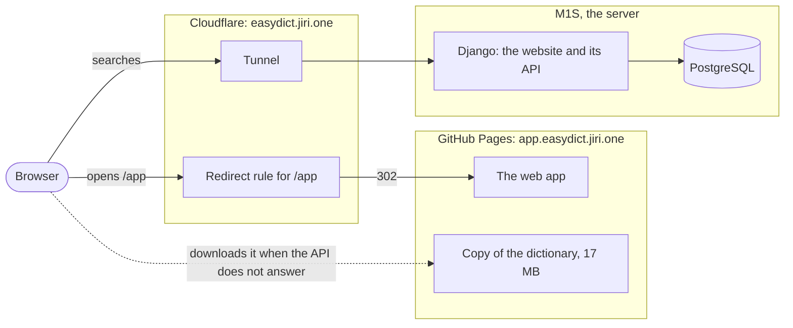
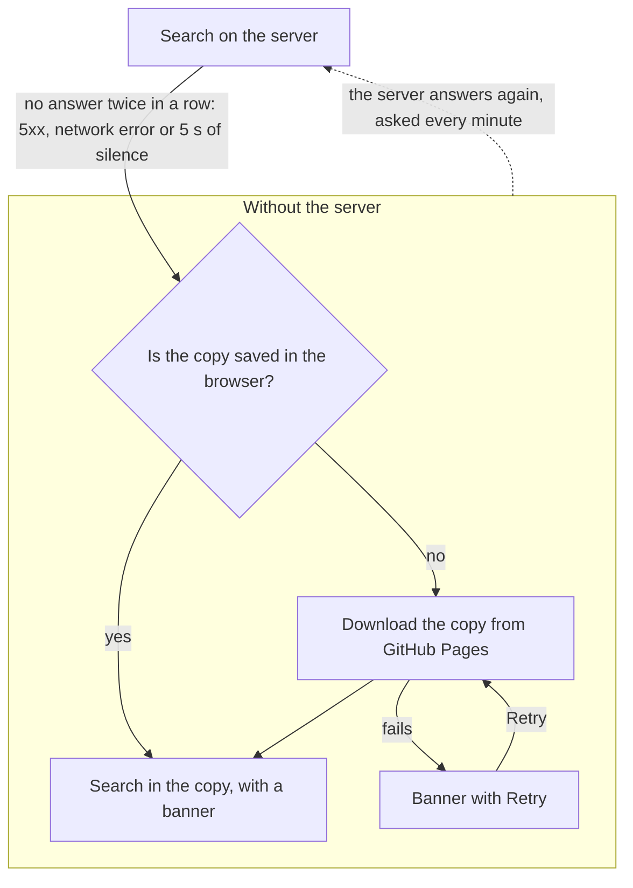
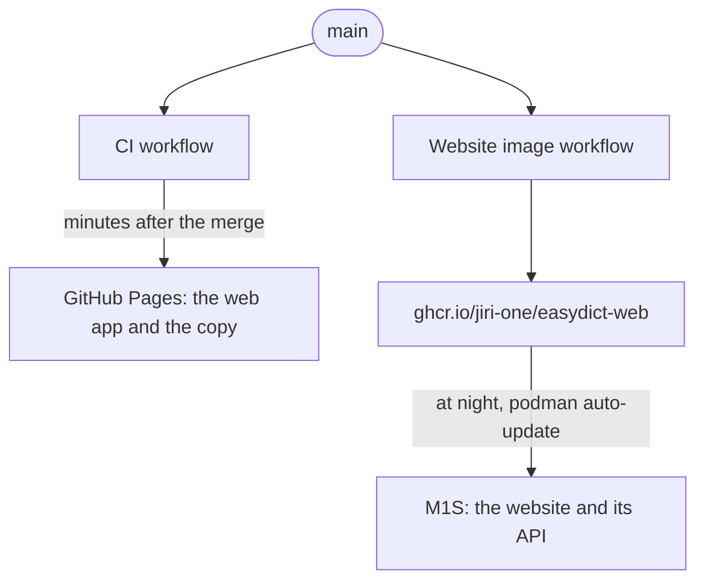

# EasyDict website
The website of the EasyDict project, [https://easydict.jiri.one](https://easydict.jiri.one): Django (Python) with PostgreSQL as the backend and some pure JavaScript as the frontend. It also answers the searches of the web app.

## The dictionary

The site searches the same dictionary as the app, in the same way: `web/dictionary.py` is a port of `app/lib/data/dictionary.dart`, and `web/tests/test_dictionary.py` runs the tests of the app against it. A change of the search belongs to both.

The data come from the SQLite database of the app, which `data/tools/build_db.py` builds from `data/` of this repository. `manage.py import_dictionary` copies it into PostgreSQL:

    python ../data/tools/build_db.py /tmp/easydict.sqlite
    python manage.py import_dictionary /tmp/easydict.sqlite             # only compares
    python manage.py import_dictionary /tmp/easydict.sqlite --replace   # imports

The production image has the database built in, and the container imports it when it starts (`--auto`), unless the import would remove translations added or changed in PostgreSQL itself, e.g. in the admin; then it only logs a warning and the site keeps its data. Until the first import, the search answers 503: a database with the records of the old site has to be imported once with `--replace` after checking the comparison. Once the site lets people add translations, those must get into `data/en-cs/en-cs.txt`, or the import must merge instead of replacing.

## The web app

The public web app lives on GitHub Pages at [app.easydict.jiri.one](https://app.easydict.jiri.one), so that it does not go down with the server (`app/tool/build_pages.sh`, deployed by the `CI` workflow from `main`). While the server answers, the app searches there and shows what the website shows, even a change from a minute ago. Only when the server does not answer does it search a copy of the dictionary in the browser.

`app.easydict.jiri.one` is a DNS-only CNAME to `jiri-one.github.io`, so it does not depend on the tunnel. A Cloudflare redirect rule sends `easydict.jiri.one/app*` there with a 302 and keeps the query, so `/app?q=dog` still searches; browsers would remember a 301, and turning the rule off would not bring them back. The app calls `/api/search` and `/api/info` of the website, which is why `WEBAPP_ORIGIN` in the settings allows that one origin to read them.

### When the server does not answer

An error switches the app to the copy within a moment; silence takes 10 s, two attempts of 5 s. The copy is the SQLite database of the offline apps, built from `data/` with every deployment. A web worker opens it with SQLite compiled to WebAssembly, and the app searches it with the same queries as the offline apps. The whole database, 51 MB unpacked, stays in memory: the storage of SQLite in a browser needs headers that GitHub Pages cannot send, and its variant without them works in one tab only. The browser keeps the downloaded file until the data change, so another outage usually downloads nothing. The banner gives the date of the last change of `data/`, because what changed only in the database of the website is not in the copy. Without the server, whether the copy is downloading, ready or failed, the app asks `/api/info` every minute; once it answers, the app goes back to the server and repeats the search. Add `?source=copy` to the address to try the copy; `app/tool/check_copy.py` checks it in a browser in CI.

| Situation | The app comes from | Search |
| --- | --- | --- |
| The server answers | GitHub Pages | on the server, the same as on the website |
| The server is down, the copy is saved in the browser | GitHub Pages | in the copy, without downloading it again |
| The server is down, no copy saved yet | GitHub Pages | in the copy, after a download of 17 MB |
| GitHub Pages is down | nowhere; with the redirect rule off, `/app` on the server | on the server |

The image still builds its own copy of the app without the fallback (`app/tool/build_web.sh`): `/app` shows it if the redirect rule is off. The view returns its `index.html`, and the container copies the rest to the static files, where it is served from `/static/app/`.

For development, build the web app and run the site with `WEBAPP_DIR=../app/build/web`; outside production, Django serves the build from `/static/app/` itself. API and page then share an origin, so no CORS is involved.

## Tests

The tests need PostgreSQL and a checkout of the whole repository (they build their data with `data/tools/build_db.py` from the fixtures of the app): `python manage.py test web`.

## Production

The production image is built from `deploy/Containerfile` with the repository as the build context:

    podman build -f web/deploy/Containerfile .

The `Website image` workflow builds it on every change of `web/`, `app/` or `data/` on `main` once the tests pass, and publishes it as `ghcr.io/jiri-one/easydict-web`. The server runs that image and updates it at night with `podman auto-update`, so whatever is merged to `main` goes live, migrations included. The web app goes live minutes after the merge and meets the website of the day before: a new API has to reach `main` a day before the app starts to use it.

## Pronunciation

The speakers in the search results and the web app use `GET /api/speech?lang=cze&q=ahoj` (or `lang=eng`), which returns mono PCM WAV from the same renderer as the app: RHVoice 1.18.4 with Radek for Czech, Piper's LJSpeech voice for English. The Pages build uses `EASYDICT_API` for both search and speech, so pronunciation comes from the website rather than Pages. `spoken_text` in `web/speech.py` is a port of `app/lib/data/speech_text.dart`, and both are tested against `app/test/fixtures/speech_text.json`: a change belongs to both. Requests accept 1–300 characters, run without a shell, and stop after twenty seconds. Only one renderer runs at a time across the workers, and a request arriving meanwhile gets a 503, which the clients retry, so speech cannot block searching. Successful responses can be cached for one day. Each request uses an isolated renderer process so a timeout cannot leave synthesis running in a web worker.

For local development:

    cmake -S ../app/native -B speech -DCMAKE_BUILD_TYPE=Release -DSPEECH_CLI=ON
    cmake --build speech -j2

The container compiles this dependency from the vendored sources. `SPEECH_EXECUTABLE` and `SPEECH_DATA` override the executable and data directories. The production image includes the engine library next to the renderer and needs no audio device. Both the website and the Pages app play this endpoint through an audio element. When the M1S is down, the dictionary copy remains searchable but pronunciation is unavailable.

For a rollout that introduces a new API, first dispatch `Website image` on the reviewed branch and deploy that image on the M1S. Verify the endpoint before merging the branch to publish the Pages app. The workflow publishes `latest` as well as the commit tag, so dispatch only a branch ready for production.

Speech licences are listed in the [main README](../README.md); see `../app/native/README.md` for the sources.
